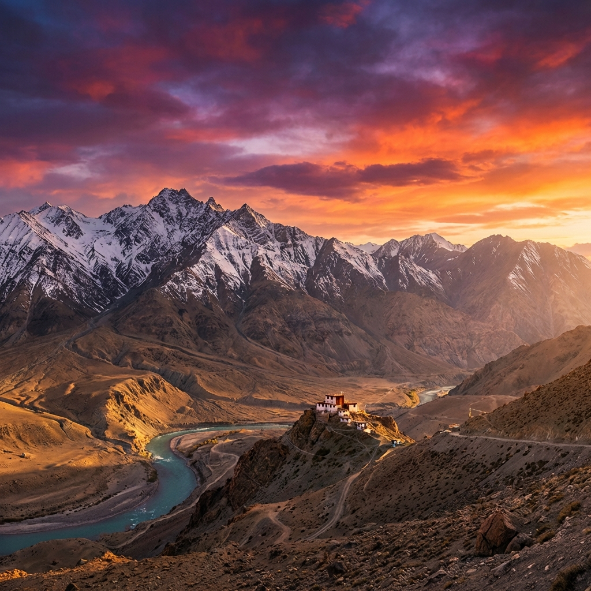

# DOKPA Expeditions - Frontend

Premium travel website for Himalayan adventures in Ladakh, India.



## 🚀 Quick Start

```bash
# Install dependencies
npm install

# Run development server
npm run dev

# Build for production
npm run build
```

Visit: http://localhost:5173

## 🎯 Features

- **Modern React SPA** with React Router
- **Dark/Light Theme Toggle** with localStorage
- **Infinite Scroll Activities Carousel** with dot indicators
- **Responsive Design** with mobile hamburger menu
- **Smooth Animations** with Intersection Observer
- **Accessibility Compliant** (WCAG AA)
- **SEO Optimized** with meta tags
- **Error Boundaries** and 404 page
- **Contact Form** with validation
- **Dedicated Activity Pages** with detailed information

## 🛠️ Tech Stack

- React 18.3.1
- React Router DOM 7.12.0
- Vite 6.0.5
- CSS3 with Custom Properties

## 📁 Project Structure

```
dokpa-expeditions/
├── docs/                    # Documentation
├── public/                  # Static assets
├── src/
│   ├── components/         # React components
│   ├── data/              # Shared data
│   ├── pages/             # Page components
│   ├── App.jsx            # Main app
│   └── index.css          # Global styles
├── index.html             # HTML template
└── package.json           # Dependencies
```

## 🌐 Pages

- **Home** (`/`) - Hero, About, Activities, Destinations, Testimonials, Contact
- **Activities** (`/activities`) - All activities grid view
- **Activity Details** (`/activities/:id`) - Individual activity pages
- **Destinations** (`/destinations`) - Destination information
- **404** - Custom not found page

## 📚 Documentation

Comprehensive documentation is available in the `docs/` folder:

- **[README.md](docs/README.md)** - Full project documentation
- **[QUICKSTART.md](docs/QUICKSTART.md)** - Quick start guide
- **[DEPLOYMENT.md](docs/DEPLOYMENT.md)** - Deployment instructions
- **[FIXES_IMPLEMENTED.md](docs/FIXES_IMPLEMENTED.md)** - All improvements made
- **[ACTIVITIES_DESIGN.md](docs/ACTIVITIES_DESIGN.md)** - Activities section design rationale
- **[ACTIVITIES_VISUAL_GUIDE.md](docs/ACTIVITIES_VISUAL_GUIDE.md)** - Visual design guide
- **[INFINITE_SCROLL_GUIDE.md](docs/INFINITE_SCROLL_GUIDE.md)** - Infinite scroll technical guide
- **[ACTIVITIES_PAGES_GUIDE.md](docs/ACTIVITIES_PAGES_GUIDE.md)** - Activities pages guide

## 🎨 Design System

### Color Palette
- **Sage Green** (#6B8E6F) - Primary accent
- **Gold** (#D4AF37) - Premium highlights
- **Charcoal** (#1A1F23) - Dark backgrounds
- **Sand** (#F7F3F0) - Light backgrounds

### Typography
- **Headings**: Outfit (serif)
- **Body**: Inter (sans-serif)

## 🚢 Deployment

Build the project:
```bash
npm run build
```

The `dist` folder contains production-ready files.

See [DEPLOYMENT.md](docs/DEPLOYMENT.md) for detailed deployment instructions.

## 📄 License

© 2024 Dokpa Expeditions. All rights reserved.

---

**Built with ❤️ in the Himalayas**
